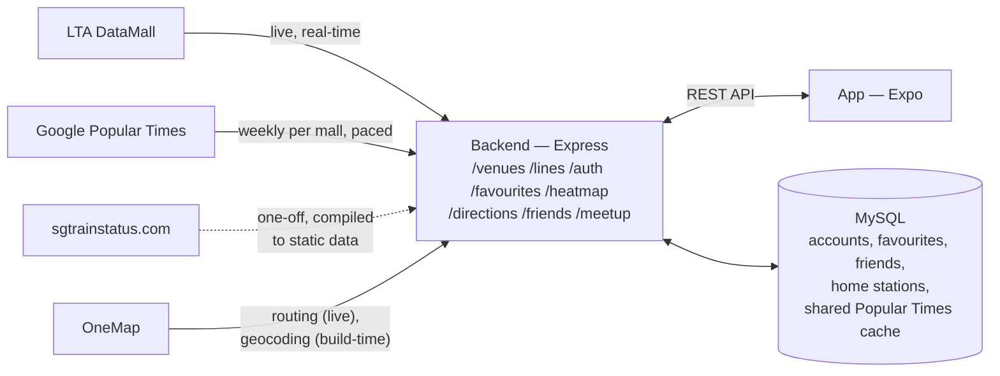

# Crowdy

NTU SC2006 Software Engineering.


<table align="center">
  <tr>
    <td align="center"><br /><sub>Crowdy Home Page</sub></td>
    <td align="center"><br /><sub>MRT/LRT stations</sub></td>
    <td align="center"><br /><sub>Heatmap Overlay</sub></td>
    <td align="center"><br /><sub>Selected and Saved Venues</sub></td>
    <td align="center"><br /><sub>Venue Details</sub></td>
  </tr>
  <tr>
    <td align="center"><br /><sub>Search Function</sub></td>
    <td align="center"><br /><sub>Meetup Planner (with Friends)</sub></td>
    <td align="center"><br /><sub>In-built Routing Planner</sub></td>
    <td align="center"><br /><sub>Detailed Route Plan</sub></td>
  </tr>
</table>


## Overview

Crowdy is a Singapore-only app for checking real-time crowd levels at MRT/LRT stations and shopping malls/attractions before heading there, with lower-crowd alternatives of the same type surfaced nearby when one exists. Groups of friends can also ask it where to meet: it suggests malls that are fair to reach for everyone and not too crowded. It's built as two independent pieces — an Expo/React Native app and a Node/Express backend.



*(Dashed arrows = one-off/build-time only, not fetched while the app is running.)*

### Features
- **Live crowd levels** — MRT/LRT stations from LTA DataMall, malls from Google Popular Times, with each mall's typical week as an hourly chart.
- **Nearby alternatives** — lower-crowd venues of the same type within 3km.
- **Right now card** — the home screen opens on mall pins and a card summing up all malls at a glance (how many are quiet, moderate, busy or closed), the crowd level most places within 2 km share, and the quietest open mall nearby.
- **Map and heatmap** — crowd-coloured pins, a rail-line layer, and an island-wide crowd heatmap overlay (iOS) where only busy malls and stations (Moderate and above) glow, so hotspots stand out.
- **Search** — find any tracked venue by name, address or postal code, forgiving small typos in names. *Address, postal code and typo search implemented by Yikai.*
- **English / 中文** — switch the whole app between English and Simplified Chinese in Settings. *Implemented by Yikai.*
- **Accounts and favourites** — save venues on the device as a guest, or sign in to sync them across devices.
- **In-app directions** — transit, walking, driving and cycling routes to a venue via OneMap, drawn on Crowdy's own map, with the live crowd level at each MRT/LRT station you board. *Implemented by Oscar.*
- **Friends** — add friends by username, accept or decline requests, and set a home station. A friend's home station is only shared once both sides have accepted.
- **Meetup planner** — pick 2–6 people (yourself, friends with a home station, or anyone by station), choose what matters most — *fairest trip* (no one travels much longer than the rest), *fastest overall* (lowest average trip) or *quietest* (least crowded mall within a reasonable trip) — and when you'll meet (now, or a day up to a week ahead with an hour on a slider), and get the top 3 malls with each person's transit time and the mall's crowd level at that time. A later time uses each mall's usual crowd at that hour from its Popular Times week, and that time's train and bus timetable. Signed-in people are listed first (you, then friends), then everyone else, and each person keeps one colour throughout. *See everyone's routes* on a suggestion shows each person's trip on one map in their colour, with leave and arrive times and step-by-step directions; with a meeting time chosen, everyone can either leave at that time or arrive by it.
- **Light and dark mode** — follows the user's choice in Settings, remembered on the device along with the language.

## Tech Stack

### Backend
- **Runtime**: Node.js, TypeScript, run via `ts-node-dev` in development
- **Framework**: Express
- **Database**: MySQL (hosted on [Aiven](https://aiven.io)'s free tier), via `mysql2`
- **Authentication**: JWT (`jsonwebtoken`) + password hashing (`bcryptjs`)
- **Scraping**: Puppeteer (`puppeteer-extra` + stealth plugin) — drives a real headless browser for Google Popular Times, since no official API exists for it
- **Other**: `cors`, native `process.loadEnvFile()` for `.env` loading (no `dotenv` dependency needed)

### Frontend
- **Framework**: Expo / React Native, TypeScript — one codebase targeting iOS, Android, and web
- **Navigation**: React Navigation (native stack)
- **Maps**: `react-native-maps` (Apple Maps on iOS by default) + `react-native-map-clustering`
- **State**: React Context (`AuthContext`, `ThemeContext`) — no external state library
- **Storage**: `expo-secure-store` (session token), `@react-native-async-storage/async-storage` (on-device saved venues for guests)
- **Icons**: `@expo/vector-icons`

## Architecture & Design Patterns

### Backend Architecture
1. **Resource-oriented routing** — one router per resource (`/venues`, `/lines`, `/auth`, `/favourites`, `/heatmap`, `/directions`, `/friends`, `/meetup`), each owning only its own resource's endpoints.
2. **Middleware for cross-cutting concerns** — `requireAuth` verifies the bearer token once and attaches the account id (via `res.locals`, not a global type augmentation) before any protected route body runs; `rateLimit` caps how often one client can call login/sign-up, meetup searches and friend requests; `cors()` and `express.json()` are applied globally.
3. **Stateless authentication** — JWT bearer tokens (30-day expiry), not server-side sessions. Every request carries everything needed to authenticate it, so the backend holds no per-user connection state.
4. **Service-layer separation** — each external concern (LTA, carpark lots, Google Popular Times, the heatmap image, alternatives, distance math, auth, meetup ranking, the DB pool) lives in its own file under `services/`. Simple resource CRUD (accounts, favourites, friends) queries the database directly from its route; anything that talks to an external source or does real computation goes through a dedicated service instead.
5. **Cache-with-TTL, repeated deliberately** — Popular Times, LTA carpark lots, and the rendered heatmap image are each cached with their own freshness window, matched to how often that specific source actually changes (5 minutes for LTA, a week for Popular Times) rather than one blanket policy.
6. **Consistent error shape** — failures return `{ error: "..." }` with a standard HTTP status (400/401/404/409/429/500/502); the same generic message is used for both "wrong password" and "no such account" on login, so a failed attempt can't be used to enumerate registered usernames.
7. **Graceful shutdown** — `SIGINT`/`SIGTERM` close the HTTP server, the shared Puppeteer browser, and the DB pool, each bounded by its own timeout so one stuck step can't block the others or the process exit itself.

### Frontend Architecture
1. **Platform-specific implementation resolution** — `VenueMap.native.tsx` / `VenueMap.web.tsx`; Metro picks the right one per platform automatically, so nothing consuming `VenueMap` ever branches on platform itself.
2. **Context/Provider pattern** — `AuthContext` and `ThemeContext` hold cross-cutting state (session, light/dark mode) without prop-drilling it through every screen.
3. **One service owns the backend, exclusively** — `services/api.ts` is the only file that constructs a request to the backend; every screen calls a named function from it instead of building its own URL/fetch call.
4. **Local-first, server-synced once signed in** — saved venues work fully offline as a guest (AsyncStorage) and transparently switch to the account's real favourites (MySQL, via the backend) once signed in, with an explicit prompt (not a silent merge) to bring guest saves into the account.
5. **Optimistic UI updates** — toggling a favourite updates local state immediately and syncs to whichever store is current (device or account) after, rather than waiting on the network round-trip to reflect the change.

## SOLID Principles Implementation

### Single Responsibility
Each backend service file owns exactly one external concern — `lta.ts` only talks to LTA's API, `popularTimes.ts` only handles the Popular Times scrape, `heatmapImage.ts` only renders the overlay image. On the client, `api.ts` owns backend communication and `savedVenues.ts` owns on-device persistence — neither touches the other's job.

### Open/Closed
Adding the heatmap didn't require modifying any existing scraper or route — it's a new, independent service that reads already-computed `Venue` data and exposes its own endpoint. The same is true of the two most recently added sources (Popular Times, then the heatmap image): each was added alongside what existed, not by editing it.

### Liskov Substitution
Every venue-like entity — a mall (Google Popular Times) or a transit station (LTA) — conforms to the same `Venue` interface regardless of its underlying data source, so any code that consumes a `Venue` (the map, the list, the Detail screen) works uniformly without knowing or caring which source it came from.

### Interface Segregation
`api.ts` exposes narrow, purpose-specific functions per need (`getFavourites`, `saveFavourite`, `getHeatmapBounds`, ...) rather than one generic request function every screen has to configure itself.

### Dependency Inversion
Routes depend on service-layer functions (`getVenues()`, `refreshPopularTimesNow()`) rather than on Puppeteer or LTA specifics directly — how a venue's crowd data is actually sourced can change without touching the route that serves it, or the app that consumes it.

## Setup Instructions

Needs Node.js 22.13+, 24.3+ or 26+ (Expo SDK 58 doesn't support the odd-numbered 23 or 25).

### Backend Setup
1. `cd server && npm install`
2. Create `server/.env` with:
   ```
   LTA_ACCOUNT_KEY=<your LTA DataMall account key>
   DB_HOST=<mysql host>
   DB_PORT=<mysql port>
   DB_NAME=<database name>
   DB_USER=<db user>
   DB_PASSWORD=<db password>
   DB_SSL_CA_PATH=./certs/aiven-ca.pem   # required for the hosted (Aiven) database; omit for a local MySQL install
   JWT_SECRET=<any random string>
   ONEMAP_EMAIL=<your OneMap account email>       # free account at onemap.gov.sg, used for directions and meetup travel times (meetup falls back to estimates without it)
   ONEMAP_PASSWORD=<your OneMap account password>
   ```
3. `npm run dev` — starts the backend at `http://localhost:4000`

Only one machine scrapes Google Popular Times; every other backend reads the shared copy from the database, so teammates need nothing extra. On the scraping machine:
1. Add `POPULAR_TIMES_SCRAPER=on` to `server/.env`. A backend only scrapes when it also has the signed-in profile from step 2, so the team can share one `.env`.
2. With the backend stopped, run `npm run google-signin`, sign in to the project's Google account in the Chrome window that opens (keep the account in that profile when asked), then quit that window.
3. Start the backend. The session is stored in `~/.crowdy/google-profile/`, outside the repo — never commit or share it. If the log says the session has expired, repeat step 2.

### App Setup
1. `cd app && npm install`
2. `npx expo login` — Expo Go only opens a project when the computer and the phone are signed in to the same Expo account (browser sign-in, so Google accounts work).
3. `npx expo start` (or `npm run ios` / `npm run android` / `npm run web`)
4. Scan the QR code with **Expo Go** (SDK 58) on the same Wi-Fi as the machine running the backend — the app resolves the backend's address automatically from Metro's own host, no manual config needed. To use another machine's backend instead, set `EXPO_PUBLIC_API_BASE_URL=http://<its address>:4000` in `app/.env` and start with `npx expo start -c`.

### Running Tests
- `cd server && npm test` — signup/login validation, favourites and friends routes, nearby alternatives, meetup ranking for each priority and meeting times, opening hours, rate limiting, plus the Lab 4 black-box (`alternatives.blackbox`) and basis path (`openingHours.basisPath`) cases. Uses an in-memory fake database, so it never touches the real one.
- `cd app && npm test` — venue search ranking, choosing a meeting time, route instruction translation, and keeping guest saves when merging into an account fails, plus the Lab 4 basis path cases for search (`venueSearch.basisPath`).

## API Documentation

### Auth — `/auth` *(10 attempts per minute per client)*
- `POST /auth/signup` — create an account (`username`, `password`), returns a session token
- `POST /auth/login` — verify credentials, returns a session token

### Venues — `/venues`
- `GET /venues?lat=&lng=` — every tracked venue, sorted nearest-first if coordinates are given
- `GET /venues/:id` — single venue detail
- `GET /venues/:id/alternatives` — lower-crowd venues of the same category within 3km
- `GET /venues/:id/popular-times` — the venue's Popular Times reading, scraping it first (~15-20s) if its pattern is over a week old and this backend scrapes
- `POST /venues/:id/popular-times/refresh` — the Refresh button on a mall's page: scrapes it now unless it was refreshed in the last 15 minutes, or on a backend that doesn't scrape, pulls the latest shared data. Returns the reading plus `status` (`updated`, `recent`, `shared` or `failed`). 5 per minute per client

### Lines — `/lines`
- `GET /lines` — static MRT/LRT rail alignment geometry

### Favourites — `/favourites` *(all require a bearer token)*
- `GET /favourites` — every venue id this account has saved
- `POST /favourites` — save one venue (`venueId`)
- `DELETE /favourites/:venueId` — unsave one venue
- `POST /favourites/merge` — bulk-save a batch of venue ids (used once, right after login, to carry over guest saves)

### Heatmap — `/heatmap`
- `GET /heatmap/image.png` — the pre-rendered crowd heatmap overlay: a transparent image with a glow around every Moderate-or-busier mall and station
- `GET /heatmap/bounds` — the geographic box that image is rendered against

### Directions — `/directions`
- `GET /directions?fromLat=&fromLng=&toId=&mode=` — one route from the user's position to a venue. `mode` is `transit` (default), `walk`, `drive` or `cycle`; one mode per request, since each is its own upstream lookup. Route geometry comes back already decoded, split into per-leg segments carrying their own colour, and every transit leg is annotated with the live crowd level at the station it boards at.

### Friends — `/friends` *(all require a bearer token)*
- `GET /friends` — this account's home station, accepted friends (with their home stations), and pending requests sent and received
- `POST /friends/requests` — send a request (`username`); if that person already sent you one, it is accepted instead. Limited to 20 per minute per client
- `POST /friends/requests/:accountId/accept` — accept a request that account sent you
- `DELETE /friends/:accountId` — remove a friend, decline their request, or cancel your own request
- `PUT /friends/home-station` — set your home station (`stationId`), or clear it with `null`

### Meetup — `/meetup` *(10 searches per minute per client)*
- `POST /meetup` — `stationIds` (2–6 MRT/LRT station ids, one per person, repeats allowed), `priority` (`fair` (default), `fast` or `quiet`) and optionally `at` (an ISO date-time within the next week; left out means now). Shortlists malls by distance, looks up each person's transit time with OneMap (falling back to a marked estimate if a lookup fails), and returns the top 3 malls with every person's travel time and the mall's crowd level. With `at`, crowd levels are each mall's usual level at that hour and routes use that time's timetable. Also says when every mall with crowd data is closed at that time. No sign-in needed, so guests can use it too.
- `POST /meetup/routes` — `stationIds` (as above, in list order), `venueId` (a mall), optionally `at` (as above) and `timing` (`leave` (default): every trip starts at `at`; `arrive`: each starts early enough to get there by it). Returns each person's public transport route with `minutes`, `leaveAt` and `arriveAt`, in the same order (`route` is null with an estimated `minutes` if OneMap can't plan a trip). Shares the meetup rate limit.

## External APIs & Services

### LTA DataMall
Official real-time MRT/LRT platform crowd density, and live carpark lot counts (shown as a bonus stat, not used to derive crowd level).

### Google Popular Times
No official API exists for this, so the backend drives a headless Chrome through the same flow a person browsing Google Maps would. Google only shows Popular Times to signed-in visitors, so it runs on a Chrome profile signed in to the project's Google account, on one machine only. It refreshes any mall whose pattern is over a week old, one mall at a time with a random 15–25 second pause between them (a scrape itself takes about 10 seconds), so all 104 take about 50 minutes — a pattern is a typical week, so weekly is plenty, and the paced, randomised timing avoids bursts of traffic on the account. Opening a mall in the app also refreshes it if its pattern is due, and the Refresh button on a mall's page refreshes it on request.

### OneMap
Two separate uses of the same free government service:
- **Geocoding** — used once at build time (`server/scripts/build-mall-list.ts`) to resolve mall coordinates. Unauthenticated, not called at runtime.
- **Routing** — called at runtime for the Directions feature and the meetup planner (walking, driving, cycling and public transport, the last running on LTA's own timetable data). This one is authenticated: the backend exchanges `ONEMAP_EMAIL`/`ONEMAP_PASSWORD` for an access token, which it caches in memory and reuses until close to expiry rather than re-authenticating per request.

Chosen over Google Directions because it needs no billing account or credit card, is authoritative for Singapore (the only country this app covers), and keeps the credential server-side either way.

### Aiven
Hosts the MySQL database (free tier) for:
- `accounts` and `favourites`
- `friendships` (one row per request, `pending` or `accepted`) and `home_stations` (one per account) — created automatically on first run, along with the rest
- `popular_times_cache` — a shared copy of the Popular Times cache, so the whole team's backends work from one set of scraped data instead of each scraping every venue separately. Each backend syncs with it on startup, every 15 minutes, and before each scraping session, and still keeps its own local copy, so the app keeps working from that copy if the database is unreachable. The table is created automatically on first run.

Everything else lives in the backend's own cache files.

## Security Features
- Passwords hashed with bcrypt (`bcryptjs`) — never stored or logged in plain text.
- JWT bearer-token authentication, verified on every protected route by the `requireAuth` middleware.
- Every SQL query is parameterized (`mysql2` placeholders, no string-built queries anywhere) — no SQL injection surface.
- Login returns the same generic error for a wrong password and for an unregistered username, so it can't be used to check which usernames exist.
- Rate limiting per client: 10 login/sign-up attempts, 10 meetup searches and 20 friend requests per minute, answered with HTTP 429 and a `Retry-After` header. This slows password guessing and username probing, and stops one client flooding OneMap through the meetup planner.
- A friend request to an unknown username gets a neutral "couldn't send" reply rather than confirming no such account exists.
- A friend's home station is only visible to accepted friends.
- Server-side username validation (`/^[a-zA-Z0-9_]{3,24}$/`) rejects anything else before it ever reaches a query.
- The connection to the hosted database is TLS-encrypted (required by Aiven); the CA certificate needed for it is committed to the repo, since it only verifies the server's identity and grants no access by itself.

## Repository Structure

```
crowdy/
├── app/                     # Expo/React Native frontend
│   ├── src/
│   │   ├── components/      # Map, venue rows, crowd badge, tab bar, charts, station picker
│   │   ├── context/         # AuthContext
│   │   ├── navigation/      # React Navigation route types
│   │   ├── screens/         # Home, Detail, Directions, Meetup, GroupRoutes, Friends, Settings
│   │   ├── services/        # api.ts (the only file that talks to the backend), local storage, distance/hours helpers
│   │   ├── theme/           # Light/dark theme + dark map style
│   │   └── types/           # Shared types (Venue, MapRegion, RailLineSegment, LayerState, friends and meetup)
│   ├── App.tsx
│   └── app.json
│
├── server/                  # Node/Express backend
│   ├── src/
│   │   ├── data/            # Known venue data (malls, stations, rail lines) + venue aggregation
│   │   ├── middleware/      # requireAuth, rateLimit
│   │   ├── routes/          # One router per resource
│   │   ├── services/        # One module per external concern (LTA, carparks, Popular Times, OneMap routing, heatmap image, auth, db, alternatives, distance, meetup, social tables)
│   │   └── types/           # Venue type (kept manually in sync with app/src/types/venue.ts)
│   ├── scripts/             # One-off build-time scripts (mall geocoding, station hours, DB schema init)
│   ├── certs/               # Aiven CA certificate (safe to commit - verifies server identity only, grants no access)
│   └── data/                # Runtime caches (gitignored) - local copy of the Popular Times cache, carpark history
│
└── deliverables/            # Lab deliverables, one folder per lab (on main only)
```

## Known Limitations
- **Android has no map.** Expo Go's own team made a deliberate decision to drop Google Maps support entirely from Expo Go (confirmed via [react-native-maps#5888](https://github.com/react-native-maps/react-native-maps/issues/5888), closed by the maintainer as "not our bug, an Expo Go decision") — not a bug in this project, and not fixable without leaving Expo Go for a custom development build. iOS is unaffected since it uses Apple Maps by default, not Google Maps.
- **Web has no map either** — `react-native-maps` has no web renderer at all; the web build shows a placeholder instead. Web was never a real target platform for this project.
- **App-to-backend traffic is plain HTTP, not HTTPS** — fine for local development on a shared Wi-Fi network, but not how this would be set up for a real deployment.
- **The crowd heatmap is iOS-only for now** — see the Features section of the team briefing for why (no gradient/heatmap layer available outside Google Maps, which Expo Go no longer supports).

## Branches
- `main` — stable/demo-ready, plus the lab deliverables
- `dev` — integration branch (all work currently happens here)
- `feature/*` — one per feature, branched from `dev`
